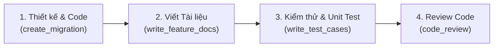

# Tài liệu Kỹ thuật Dự án World of Self (WOS)

Thư mục này lưu trữ toàn bộ tài liệu thiết kế và đặc tả kỹ thuật cho các tính năng của dự án **World of Self** (Backend NestJS/MikroORM & Frontend Next.js).

> [!TIP]
> Khi phát triển một tính năng mới, sử dụng kỹ năng **`write_feature_docs`** (`.agent/skills/write_feature_docs/SKILL.md`) để khởi tạo hoặc cập nhật tài liệu tính năng theo khung chuẩn trước khi tiến hành kiểm thử (`write_test_cases`) và review code (`code_review`).

---

## Quy trình Phát triển Tính năng Chuẩn

---

## Danh mục Tài liệu Tính năng (`docs/features/`)

| STT | Tên tính năng | File tài liệu | Phân hệ | Trạng thái | Cập nhật cuối |
| :-: | :--- | :--- | :--- | :---: | :---: |
| 1 | **Quản lý & Gửi Nhãn dán (Chat Stickers)** | [chat-stickers.md](./features/chat-stickers.md) | Admin, Chat, Realtime, MinIO | `Ready for Test` | 2026-10-27 |

