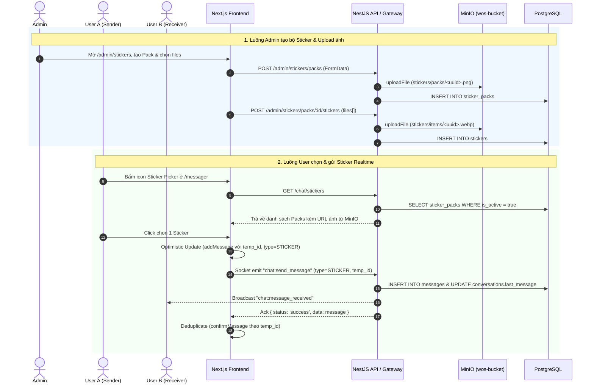

# Tài liệu Tính năng: Quản lý & Gửi Nhãn dán (Chat Stickers)

- **Trạng thái**: `Ready for Test`
- **Cập nhật lần cuối**: 2026-10-27
- **Phân hệ liên quan**:
  - Backend: `modules/admin/stickers`, `modules/sticker`, `modules/chat`, `modules/minio`
  - Frontend: `app/(main)/admin/stickers`, `app/messager`, `components/chat/StickerPicker.tsx`

---

## 1. Tổng quan & Mục tiêu (Overview)
- **Mục tiêu**: Cho phép người dùng gửi nhãn dán (Sticker) theo thời gian thực trong cuộc trò chuyện (`/messager`), đồng thời cung cấp công cụ cho Quản trị viên (`/admin/stickers`) tạo, quản lý các bộ nhãn dán (Sticker Packs) và tải lên hàng loạt ảnh sticker lưu trữ trên MinIO (S3).
- **Phân quyền**:
  - `UserRole.Admin`: Toàn quyền thêm/sửa/xóa bộ sticker, ẩn/hiện (`is_active`), upload hàng loạt hoặc xóa lẻ từng sticker.
  - `UserRole.User` & `UserRole.Admin`: Xem danh sách các bộ sticker đang hoạt động (`is_active = true`) và gửi sticker trong khung chat.

---

## 2. Sơ đồ Luồng hoạt động (Workflow / Sequence Diagram)

---

## 3. Thiết kế Cơ sở dữ liệu (Database Schema)

- **Entities liên quan**:
  - [`StickerPack`](file:///home/duczz/Documents/world-of-self/backend/src/entities/src/entities/StickerPack.ts)
  - [`Sticker`](file:///home/duczz/Documents/world-of-self/backend/src/entities/src/entities/Sticker.ts)
  - [`Message`](file:///home/duczz/Documents/world-of-self/backend/src/entities/src/entities/Message.ts) (`MessageType.STICKER`)
- **Migration**: [`Migration20261009100000_add_sticker_packs_and_stickers_tables.ts`](file:///home/duczz/Documents/world-of-self/backend/src/entities/src/migrations/Migration20261009100000_add_sticker_packs_and_stickers_tables.ts)

| Tên bảng | Cột chính | Kiểu dữ liệu | Ràng buộc / Ghi chú |
| :--- | :--- | :--- | :--- |
| `sticker_packs` | `id`, `name`, `description`, `icon_url`, `is_active`, `sort_order` | `uuid`, `varchar`, `text`, `boolean`, `int` | PK `id`, có `created_at`, `updated_at`, `deleted_at` |
| `stickers` | `id`, `pack_id`, `name`, `image_url`, `sort_order` | `uuid`, `uuid`, `varchar`, `text`, `int` | FK `pack_id` -> `sticker_packs(id)` (`ON DELETE CASCADE`) |
| `messages` | `id`, `conversation_id`, `sender_id`, `content`, `type` | `uuid`, `uuid`, `uuid`, `text`, `varchar` | Khi `type = 'STICKER'`, `content` lưu đường dẫn/URL ảnh sticker |

---

## 4. Đặc tả Backend (REST API & WebSocket)

### 4.1. REST Endpoints
| Method | Endpoint | Quyền (`@Auth`) | Request Payload / DTO | Response Format | Mô tả |
| :--- | :--- | :--- | :--- | :--- | :--- |
| `GET` | `/chat/stickers` | `User, Admin` | None | `{ data: StickerPack[] }` | Lấy danh sách bộ sticker đang `is_active = true` |
| `GET` | `/admin/stickers/packs` | `Admin` | None | `{ data: StickerPack[] }` | Lấy tất cả bộ sticker cho Admin |
| `GET` | `/admin/stickers/packs/:id` | `Admin` | `@Param('id')` | `{ data: StickerPack }` | Xem chi tiết 1 bộ sticker |
| `POST` | `/admin/stickers/packs` | `Admin` | `CreateStickerPackDto` + `icon` file | `{ data: StickerPack, message }` | Tạo bộ sticker mới |
| `PATCH` | `/admin/stickers/packs/:id` | `Admin` | `UpdateStickerPackDto` + `icon?` file | `{ data: StickerPack, message }` | Sửa thông tin, thứ tự, ẩn/hiện hoặc đổi icon |
| `DELETE` | `/admin/stickers/packs/:id` | `Admin` | `@Param('id')` | `{ message }` | Xóa bộ sticker & xóa ảnh trên MinIO |
| `POST` | `/admin/stickers/packs/:id/stickers` | `Admin` | `files` (tối đa 50 ảnh) | `{ data: Sticker[], message }` | Upload hàng loạt sticker vào bộ |
| `DELETE` | `/admin/stickers/:id` | `Admin` | `@Param('id')` | `{ message }` | Xóa lẻ 1 sticker |

### 4.2. WebSocket Events (`/chat` namespace)
| Event Name | Chiều | Payload DTO | Ack / Broadcast Format |
| :--- | :--- | :--- | :--- |
| `chat:send_message` | Client -> Server | [`WsSendMessageDto`](file:///home/duczz/Documents/world-of-self/backend/src/modules/chat/dto/send-message.dto.ts) (`type: MessageType.STICKER`) | `{ status: 'success' \| 'error', data: Message, message?: string }` |
| `chat:message_received` | Server -> Room | `Message` (`type: MessageType.STICKER`) | `{ status: 'success', data: Message }` |

---

## 5. Kiến trúc Frontend (Next.js)
- **Routes / Pages**:
  - Trang Quản trị Sticker: [`frontend/src/app/(main)/admin/stickers/page.tsx`](file:///home/duczz/Documents/world-of-self/frontend/src/app/(main)/admin/stickers/page.tsx) (Link hiển thị trên [`MainSidebar.tsx`](file:///home/duczz/Documents/world-of-self/frontend/src/components/layout/MainSidebar.tsx) khi `user.role === 'admin'`).
  - Trang Chat: [`frontend/src/app/messager/page.tsx`](file:///home/duczz/Documents/world-of-self/frontend/src/app/messager/page.tsx).
- **Components**:
  - [`StickerPicker.tsx`](file:///home/duczz/Documents/world-of-self/frontend/src/components/chat/StickerPicker.tsx): Menu chọn sticker theo từng tab bộ nhãn dán.
- **Services & Hooks**:
  - [`stickerService.ts`](file:///home/duczz/Documents/world-of-self/frontend/src/services/stickerService.ts)
  - [`useStickers.ts`](file:///home/duczz/Documents/world-of-self/frontend/src/hooks/sticker/useStickers.ts) (`QueryKey.stickers`, `QueryKey.adminStickers`).
- **State / Realtime**:
  - [`chatStore.ts`](file:///home/duczz/Documents/world-of-self/frontend/src/store/chatStore.ts): Cập nhật `messages` và `conversations[].last_message` ngay khi `addMessage` (Optimistic UI) và `confirmMessage` (Deduplication theo `temp_id`).

---

## 6. Checklist Trước Khi Kiểm Thử (Pre-Test Readiness)
- [x] Migration đã có cả `up()` và `down()`, kế thừa `MigrationWithTimestamps`.
- [x] Không sử dụng kiểu `any` ở cả Backend và Frontend (`no_any.md`).
- [x] Đã kiểm tra phân quyền `@Auth(...)` cho cả `User` và `Admin`.
- [x] Đã viết Unit Test (`sticker.service.spec.ts`, `admin-stickers.service.spec.ts`) và pass 7/7 tests.

